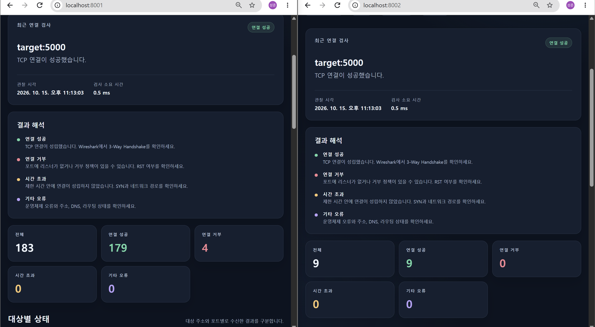
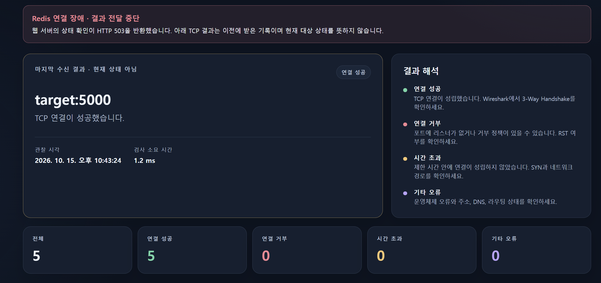
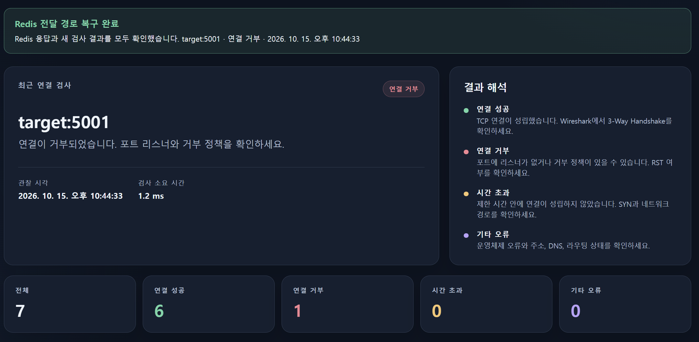
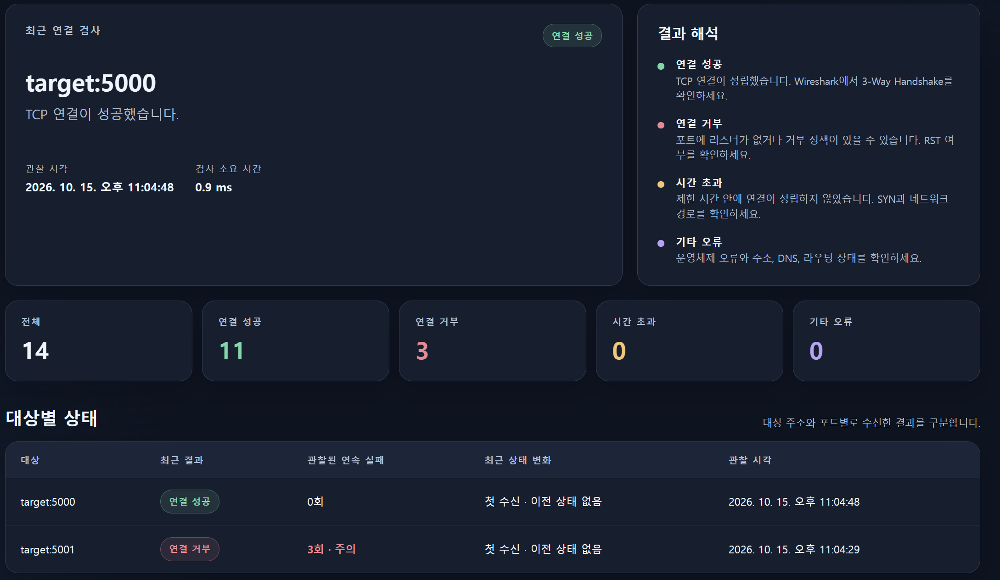
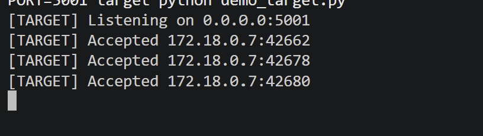
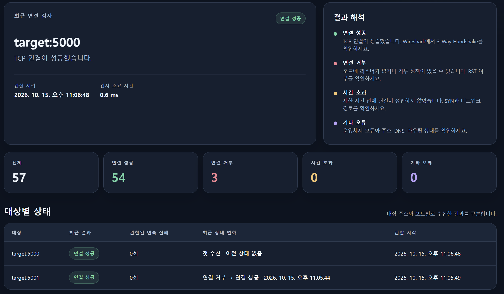
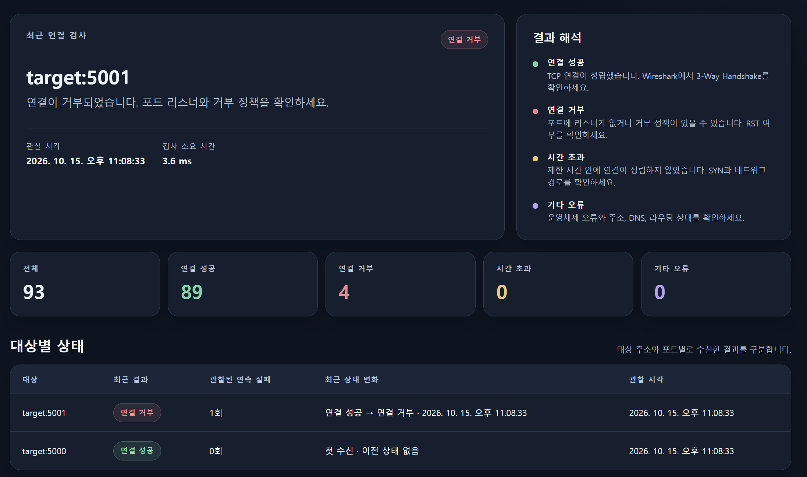
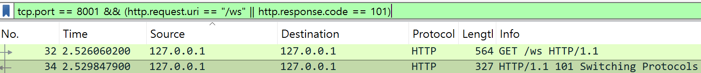
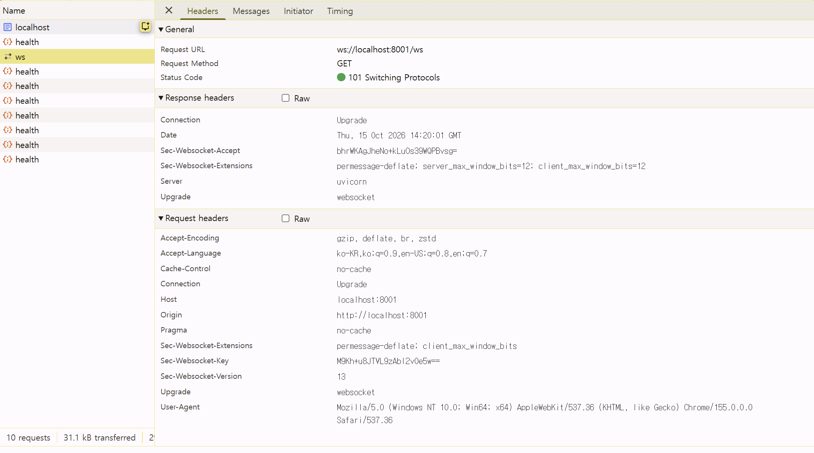
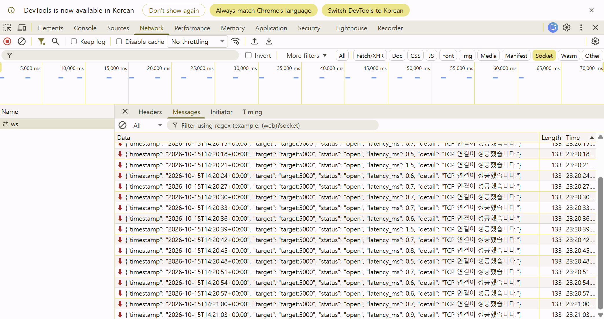

# TCP Realtime Monitoring Lab

Python의 TCP 연결 검사를 실시간 이벤트로 만들고, Redis Pub/Sub과 WebSocket을 거쳐 두 웹 서버의 대시보드에 전달하는 네트워크 트러블슈팅 실습입니다. 기존의 단일 TCP Client/Server 실습에서 한 단계 더 나아가 **연결 결과를 수집하고, 서로 다른 서비스 사이로 전달하며, 장애의 근거와 한계를 함께 기록**합니다.

> 이 저장소는 재현 가능한 실습 환경과 배포 절차를 제공합니다. 로컬 실습에서 두 대시보드의 같은 검사 결과, 대상별 상태 변화, Redis 장애·복구, WebSocket 업그레이드와 이벤트 본문 화면을 확보했습니다. 추가 패킷·로그는 실제로 관찰한 경우에만 보완하며, AWS 배포는 아직 진행하지 않은 선택 절차입니다.

## 1. Project Overview

네트워크 엔지니어는 애플리케이션의 “접속 안 됨”이라는 증상에서 출발해 대상 주소, 포트, 리스너, 경로, 방화벽을 차례로 확인해야 합니다. 이 프로젝트는 `socket.connect()` 결과를 `open`, `refused`, `timeout`, `error`로 구분하고 시도 시간을 측정합니다. 두 웹 서버에 전달된 결과를 브라우저에서 대상별로 구분해 상태 변화와 연속 실패를 관찰하고, TCP 연결 상태와 결과 전달 경로의 장애를 나누어 분석합니다.

핵심 관찰 흐름은 **구현 → 정상 연결 관찰 → 장애 재현 → 패킷·로그·화면 대조 → 가능한 원인 추론**입니다. 상태 하나만으로 원인을 확정하지 않고, 관찰한 계층과 추가 확인이 필요한 계층을 구분합니다.

## 2. Architecture

```text
                         Docker Compose 네트워크

                        TCP connect()
  +-----------+       +--------------------> +------------------+
  |   probe   |                               | target:5000      |
  | 3초 주기  | <---------------------------- | TCP demo server  |
  +-----+-----+        성공 또는 소켓 오류     +------------------+
        |
        | PUBLISH tcp-probe-events
        v
  +-----------+      SUBSCRIBE       +-----------+    ws://localhost:8001/ws
  |   Redis   | -------------------> |   web_a   | --------------------> Browser A
  |  :6379    |                      +-----------+
  | 내부 전용 |      SUBSCRIBE       +-----------+    ws://localhost:8002/ws
  |           | -------------------> |   web_b   | --------------------> Browser B
  +-----------+                      +-----------+
```

`probe`는 기본적으로 Compose 내부의 `target:5000`에 연결을 시도합니다. 검사 결과를 Redis 채널 `tcp-probe-events`에 발행합니다. `web_a`와 `web_b`는 각 브라우저의 WebSocket 연결에서 채널을 구독합니다. 두 브라우저가 **서로 다른 웹 인스턴스**에 접속해도 같은 이벤트를 받으면, Redis가 인스턴스 사이의 전달 경로라는 사실을 확인할 수 있습니다.

AWS 배포에서는 선택적인 `caddy` 서비스가 앞단에서 HTTPS와 WebSocket 프록시를 맡습니다. 기본 로컬 실습에는 Caddy가 필요하지 않습니다.

## 3. Tech Stack

| 구성 | 역할 |
| --- | --- |
| Python `socket` | TCP 연결 시도와 결과 분류 |
| FastAPI · Uvicorn | HTTP 대시보드, `/health`, `/ws` WebSocket 엔드포인트 |
| Redis Pub/Sub · `redis.asyncio` | `probe`와 두 웹 인스턴스 사이의 이벤트 전달 |
| Docker Compose | 서비스 실행, 내부 DNS, 컨테이너 간 네트워크 |
| HTML · 브라우저 WebSocket API | 실시간 상태 표시. 별도 프런트엔드 패키지 없음 |
| Caddy · AWS EC2 | 선택적 HTTPS/WSS 배포 경로 |
| Wireshark | 브라우저 쪽 TCP·HTTP Upgrade·WebSocket 트래픽 관찰 |

Python 패키지는 `requirements.txt`에 정리했습니다. Redis는 Python 패키지만 설치해서 동작하는 서비스가 아니므로 Docker Compose가 Redis 서버 컨테이너를 실행합니다.

## 4. Project Structure

```text
tcp-realtime-monitoring-lab/
├── app.py                 # FastAPI 대시보드 및 WebSocket
├── probe.py               # TCP 연결 검사 및 Redis 발행
├── demo_target.py         # 실습용 TCP 리스너
├── static/
│   └── index.html         # 실시간 대시보드
├── compose.yaml           # 로컬 서비스와 선택적 aws 프로필
├── Dockerfile             # Python 서비스 이미지
├── Caddyfile              # AWS HTTPS/WSS 프록시 설정
├── requirements.txt
├── .env.example            # 배포 설정 예시
├── .gitignore
├── .dockerignore
├── docs/
│   ├── aws-ec2.md         # EC2 배포·보안 그룹·정리 절차
│   └── wireshark-evidence.md  # 화면·패킷·로그 증거 수집 가이드
├── images/
│   ├── .gitkeep           # 스크린샷 폴더 유지
│   ├── 대시보드_8001_8002.png # 8001·8002 같은 검사 결과
│   ├── 레디스_장애.png   # Redis 중지 화면
│   ├── 레디스_복구.png # Redis 복구 화면
│   ├── 대상5001_연속실패.png # 대상별 연결 거부 3회
│   ├── 대상5001_임시서버.png # 임시 리스너 수락 기록
│   ├── 대상5001_연결복구.png # 연결 거부 → 성공
│   ├── 대상5001_재거부.png # 연결 성공 → 거부
│   ├── 웹소켓_연결전환.png # Wireshark의 /ws 요청과 HTTP 101
│   ├── 웹소켓_요청응답_헤더.png # Chrome 개발자 도구의 Upgrade 헤더
│   └── 웹소켓_수신메시지.png # Chrome 개발자 도구의 JSON 메시지
└── README.md
```

## 5. Local Run — Windows 10/11

준비물: Linux 컨테이너 모드의 Docker Desktop과 Docker Compose, 브라우저, 선택적으로 Wireshark/Npcap. VSCode 터미널은 PowerShell을 사용해도 됩니다. 아래 명령은 **이 README가 있는 프로젝트 폴더**에서 실행합니다.

```powershell
docker compose up --build -d
docker compose ps
```

`redis`, `target`, `probe`, `web_a`, `web_b`의 상태를 확인합니다. 브라우저 창 또는 탭 두 개를 열어 각각 다음 주소에 접속합니다.

- 브라우저 A: <http://localhost:8001/>
- 브라우저 B: <http://localhost:8002/>

두 화면의 WebSocket 연결 표시가 활성화되고, 기본 대상 `target:5000`의 **연결 성공** 결과가 약 3초 간격으로 추가되는지 확인합니다. 화면에는 한국어 상태 이름이 보이지만 이벤트 JSON과 로그의 `status` 값은 `open`, `refused`, `timeout`, `error`를 사용합니다. 각 화면에 표시되는 포트가 달라야 서로 다른 웹 인스턴스를 시험한 것입니다. `web_a`·`web_b` 로그에는 각 인스턴스 이름과 전달 기록이 남으므로 어느 서버가 이벤트를 보냈는지도 대조할 수 있습니다. 대시보드의 최근 기록과 상태별 숫자는 **현재 브라우저가 받은 이벤트** 기준이며, 영구 저장된 이력은 아닙니다.

아래 실제 화면에는 `localhost:8001`과 `localhost:8002`가 모두 `target:5000`의 연결 성공을 같은 관찰 시각과 검사 소요 시간으로 표시합니다. 누적 건수가 서로 다른 것은 두 브라우저가 화면을 연 뒤 받은 이벤트 수가 다르기 때문입니다. 이 화면은 두 웹 인스턴스에 결과가 도착한 근거이며, 각각의 전달 경로는 `web_a`·`web_b` 로그와 함께 확인합니다.



로그를 함께 봅니다.

```powershell
docker compose logs -f probe web_a web_b target
```

PowerShell에서 `Ctrl+C`는 로그 보기만 중단합니다. 실습 종료 시 컨테이너를 내립니다.

```powershell
docker compose down
```

### 서비스 이름과 `localhost`의 차이

Compose 네트워크에서 `target`과 `redis`는 서비스 이름으로 찾습니다. **컨테이너 안의 `127.0.0.1`은 그 컨테이너 자신**이므로 `probe`에서 `127.0.0.1:5000`으로 접속하면 `target` 컨테이너가 아니라 `probe` 컨테이너의 5000번 포트를 확인합니다. 호스트의 `localhost:8001`과 컨테이너의 `target:5000`을 구분하는 것이 이 실습의 핵심입니다.

## 6. Data Flow — TCP에서 WebSocket까지

1. `probe.py`가 목적지 호스트와 포트에 IPv4 TCP 연결을 시도합니다.
2. 성공 또는 예외를 분류하고, 연결 시도에 걸린 시간을 밀리초 단위로 기록합니다. 호스트 이름을 사용할 때는 이름 해석 시간도 포함될 수 있으며, 이 값은 **ICMP ping 왕복 시간**이 아닙니다.
3. `probe`가 검사 결과를 Redis 채널 `tcp-probe-events`에 발행합니다.
4. `web_a`와 `web_b`는 각각 채널을 구독해 자기에게 연결된 브라우저로 이벤트를 전달합니다.
5. 브라우저는 `/ws` WebSocket 연결에서 받은 JSON을 최근 결과 표에 표시합니다.

브라우저와 웹 서버가 처음 연결할 때는 TCP 연결 위에서 HTTP/1.1 **Upgrade** 요청과 `101 Switching Protocols` 응답을 교환할 수 있습니다. 이후 같은 연결에서 WebSocket 프레임이 오갑니다. WebSocket은 TCP 위에서 동작하며, Redis Pub/Sub은 **별도의 서비스 간 통신 경로**입니다. [FastAPI WebSocket 설명](https://fastapi.tiangolo.com/advanced/websockets/)

Redis Pub/Sub은 현재 접속한 구독자에게 메시지를 전달하는 **at-most-once** 방식입니다. 구독자가 끊긴 동안 발행된 메시지를 저장하거나 나중에 재생하지 않으므로 이 대시보드는 영구 이력 저장 시스템이 아닙니다. [Redis Pub/Sub 전달 특성](https://redis.io/docs/latest/develop/use-cases/pub-sub/)

## 7. Scenario A — Normal Connection

위의 기본 실행 상태에서는 `demo_target.py`가 컨테이너 내부의 TCP 5000번 포트에서 대기합니다. `probe`가 `target:5000` 연결에 성공하면 화면에 **연결 성공**(`status: open`)이 나타납니다. 이것은 **해당 순간 TCP 연결이 성립했다**는 증거입니다. 연결 성공만으로 실제 서비스의 모든 기능이나 데이터 응답까지 정상이라고 말할 수는 없습니다.

확인할 근거:

- 브라우저 A와 B 모두 같은 대상의 **연결 성공**(`open`) 이벤트를 받는지
- `docker compose logs -f probe target`에 검사와 수락 기록이 있는지
- `docker compose ps`에서 `target`과 `probe`가 실행 중인지

## 8. Scenario B — Connection Refused

기본 서비스가 실행되고 두 브라우저 탭이 열린 상태에서 별도의 일회성 검사를 실행합니다.

```powershell
docker compose run --rm -e TARGET_HOST=target -e TARGET_PORT=5001 probe python probe.py --once
```

`target`은 Docker Compose가 제공하는 서비스 DNS 이름이므로 일회성 `probe`가 **다른 컨테이너의** TCP 5001번 포트로 연결을 시도합니다. `demo_target.py`는 `target:5000`에서만 대기하므로 `target:5001`에는 리스너가 없고 일반적으로 화면에 **연결 거부**(`status: refused`)가 나타납니다. `--rm`은 검사 후 일회성 컨테이너를 제거합니다. 이미 실행 중인 정기 검사기는 계속 `target:5000`을 확인하므로 **연결 성공**과 **연결 거부** 이벤트가 섞여 보일 수 있습니다. **대상 포트까지 함께 확인**하세요.

패킷 관점에서는 SYN 뒤에 대상 TCP 스택의 RST/ACK가 관찰될 수 있습니다. 다만 이 왕복 경로는 **Docker 내부**이므로 Windows 호스트의 Loopback 캡처에 보인다고 가정하지 않습니다. `refused` 또는 RST 하나만으로 “서버 프로세스가 꺼졌다”고 확정하지 않습니다. 잘못된 포트, 호스트의 거부 정책, 방화벽 Reject 등도 추가 확인 대상입니다. `target` 컨테이너를 단순히 중지하면 Compose DNS·네트워크 상태에 따라 이름 해석 오류 등 다른 결과가 나올 수 있으므로 위 명령을 재현 절차로 사용합니다.

## 9. Scenario C — Connection Timeout

**일부 환경에서 응답이 없는 것으로 확인된 대상**을 선택해 일회성 검사를 실행합니다. 아래 주소는 실습용 예시이며 반드시 시간 초과를 만들지는 않습니다.

```powershell
docker compose run --rm -e TARGET_HOST=192.168.100.250 -e TARGET_PORT=5000 -e CONNECT_TIMEOUT=3 probe python probe.py --once
```

실제로 3초 내 응답을 받지 못하면 화면에 **시간 초과**(`status: timeout`)가 기록될 수 있습니다. 운영체제, Docker 네트워크, 라우팅, ARP/게이트웨이, 대상 호스트, 중간 장비에 따라 **즉시 기타 오류(`error`)나 연결 거부(`refused`)가 나올 수도 있고 TCP SYN이 전송되지 않을 수도 있습니다.** 시간 초과가 재현되지 않았다면 다른 결과를 그대로 기록하고, 이 화면을 시간 초과의 증거로 사용하지 않습니다.

SYN과 재전송이 보이고 응답이 없다면 그 사실을 관찰 결과로 적습니다. 가능한 원인은 Firewall Drop, ACL, 라우팅 문제, 대상 호스트 다운 등 다양하므로 Wireshark 한 화면만으로 특정 원인을 단정하지 않습니다.

Docker Desktop에서 이 일회성 검사는 컨테이너에서 외부로 나갑니다. 캡처 가능한 구간에 따라 Windows의 **Wi-Fi 또는 Docker 가상/NAT 인터페이스**에서 보일 수 있으니 먼저 어느 인터페이스에 목적지 트래픽이 나타나는지 확인합니다. Wireshark **Display Filter**는 다음과 같이 좁힐 수 있습니다.

```text
ip.addr == 192.168.100.250 && tcp.port == 5000
```

아무 패킷도 보이지 않으면 이 표시 필터를 지우고 ARP·ICMP·경로 관련 트래픽이 있는지 살핍니다. SYN이 Windows에서 보이지 않는다는 사실만으로 컨테이너 안에서도 SYN이 전송되지 않았다고 결론 내리지 않습니다.

| 화면 표시 (`status` 값) | `probe`가 확인한 사실 | 다음 확인 |
| --- | --- | --- |
| 연결 성공 (`open`) | 제한 시간 안에 TCP 연결 성립 | 애플리케이션 요청·응답이 정상인지 |
| 연결 거부 (`refused`) | 연결 시도가 명시적으로 거부됨 | 목적지 포트, 리스너, Reject 정책, RST 여부 |
| 시간 초과 (`timeout`) | 설정한 시간 안에 연결 완료 응답을 받지 못함 | SYN·재전송, 경로, 방화벽/ACL, 대상 상태 |
| 기타 오류 (`error`) | 다른 OS·주소 해석·네트워크 오류 발생 | 오류 메시지, DNS, 주소와 라우팅 |

## 10. Scenario D — Redis 장애와 복구

이 실험은 **검사 대상 `target:5000`은 살아 있지만 결과 전달 경로인 Redis가 멈춘 경우**를 재현합니다. 대시보드에 새 결과가 없다는 증상만으로 대상 서버 장애라고 판단하지 않고, TCP 검사 로그·Redis 상태·웹 서버의 `/health`를 함께 확인합니다. 실험은 로컬 Compose 환경에서 진행합니다.

### 1) 정상 상태 기록

프로젝트 폴더의 PowerShell에서 서비스를 실행하고 두 브라우저 탭을 열어 `http://localhost:8001/`, `http://localhost:8002/`의 최근 이벤트 시각이 계속 바뀌는지 확인합니다. 별도 터미널에서는 로그를 열어 둡니다.

```powershell
docker compose up --build -d
docker compose ps
curl.exe -i http://localhost:8001/health
curl.exe -i http://localhost:8002/health
```

```powershell
docker compose logs -f --tail=20 probe target web_a web_b
```

정상 기준은 두 `/health` 응답의 HTTP 200, `target:5000`의 새 `open` 이벤트, `probe`의 발행 로그입니다. 화면 오른쪽의 「결과 해석」은 가능한 상태의 설명이며, 실제 발생 횟수는 아래 숫자 카드에 표시됩니다. 기본 대상이 계속 응답하면 연결 성공 수만 증가합니다. 로그를 따라보는 터미널은 계속 열어 두고 다음 명령은 첫 번째 터미널에서 실행합니다.

### 2) Redis 중지 후 장애 범위 확인

```powershell
docker compose stop redis
docker compose ps --all
curl.exe -i http://localhost:8001/health
curl.exe -i http://localhost:8002/health
docker compose logs --tail=30 probe target web_a web_b
```

`ps --all`에서 `redis`가 중지됐는지 확인합니다. 두 웹 서버가 계속 실행 중이라면 `/health`는 Redis 연결 실패를 HTTP 503으로 알립니다. 약 10초 동안 `probe` 로그에 `Redis publish failed`와 **전달되지 못한 TCP 검사 결과**가 함께 기록되는지 확인합니다. 결과가 `open`이고 `target`의 수락 로그도 계속 증가한다면 TCP 대상은 응답하지만 이벤트 발행이 실패한 것으로 해석할 수 있습니다. 브라우저에서는 붉은 **「Redis 연결 장애 · 결과 전달 중단」** 안내가 나타나고 새 이벤트가 멈추는지 확인합니다. 마지막 `open` 결과와 누적 수치는 남아 있지만, 최근 결과 카드에 **「현재 상태 아님」**이라고 표시됩니다. 이 안내는 웹 서버의 `/health` 응답을 3초마다 확인해 표시하며, 대상 TCP 연결 성공 여부 자체를 알려주는 것은 아닙니다.

### 3) Redis 재시작 후 복구 확인

```powershell
docker compose start redis
docker compose ps
curl.exe -i http://localhost:8001/health
curl.exe -i http://localhost:8002/health
docker compose logs --tail=30 probe web_a web_b
```

두 `/health`가 다시 HTTP 200을 반환하고, `probe`의 발행 성공 로그와 두 화면의 **새 시각** `open` 이벤트가 나타나는지 확인합니다. Redis가 응답하지만 아직 새 이벤트가 없다면 화면에 **「전달 경로 복구 · 새 결과 대기 중」**이 보입니다. 새 이벤트까지 받으면 **「Redis 전달 경로 복구 완료」** 안내가 약 30초 동안 나타납니다. 이 안내를 보려면 Redis를 중지하기 전부터 같은 브라우저 탭을 열어 두고, 중지와 재시작 동안 새로고침하지 않아야 합니다. 새로고침하면 화면이 기억하던 장애 이력이 초기화됩니다. `target:5000`은 계속 실행 중이므로 복구 후에도 정상적인 결과는 `open`이며, 연결 거부나 시간 초과가 자동으로 생기지 않습니다. 브라우저의 WebSocket이 자동 재연결되지 않으면 두 탭을 새로고침하고, 그 사실도 기록합니다. 장애 중 놓친 이벤트가 복구 후 한꺼번에 나타나지는 않습니다. Redis Pub/Sub은 끊긴 구독자에게 과거 메시지를 재전송하지 않습니다. [Docker Compose `stop`](https://docs.docker.com/reference/cli/docker/compose/stop/), [`start`](https://docs.docker.com/reference/cli/docker/compose/start/), [Redis Pub/Sub 전달 특성](https://redis.io/docs/latest/develop/pubsub/)

| 단계 | 확인할 근거 | 판단 |
| --- | --- | --- |
| 정상 | `/health` 200, `probe` 발행 성공, 새 `open` 이벤트 | TCP 검사와 이벤트 전달 경로가 모두 동작 |
| Redis 중지 | Redis 중지 상태, `/health` 503, `Redis publish failed`, `target` 수락 여부 | 대상 연결과 결과 전달 장애를 분리해 판단 |
| Redis 복구 | `/health` 200, 발행 재개, 두 화면에 새 이벤트 | 전달 경로가 다시 동작하는지 확인 |

아래 화면은 Redis 중지 시 대시보드가 `/health`의 HTTP 503을 감지해 결과 전달 장애를 표시한 장면입니다. 카드의 `연결 성공`은 장애 전에 받은 마지막 결과이며, 화면에 표시된 대로 현재 대상 상태의 증거가 아닙니다. 대상 TCP 검사가 계속됐는지는 같은 시점의 `probe`와 `target` 로그로 확인해야 합니다.



아래 복구 화면은 Redis가 다시 응답하고 웹 화면에 **새 검사 결과가 도착한 것**을 보여줍니다. `target:5001`의 **연결 거부**는 Scenario B의 일회성 검사에서 의도적으로 만든 결과입니다. 이 결과가 대시보드에 도착했다는 사실은 전달 경로의 복구 근거이지만, `target:5000`의 현재 연결 상태를 뜻하지는 않습니다.



포트폴리오에는 **실제 실행 날짜**, 중지·복구 시각, 두 화면과 터미널에서 본 결과를 기록합니다. 정상 연결 화면은 `images/대시보드_8001_8002.png`, Redis 중지와 복구 화면은 `images/레디스_장애.png`와 `images/레디스_복구.png`에 저장했습니다. 연결 거부 또는 시간 초과 결과도 필요하면 각각 위의 Scenario B, C에 나온 일회성 `probe` 명령을 별도로 실행합니다. 확인하지 않은 결과를 실험 성공으로 적지 않습니다.

## 11. Scenario E — 대상별 상태 변화와 연속 실패

대시보드는 **전달 경로가 정상인 동안 브라우저가 받은 이벤트**를 대상 문자열별로 따로 추적합니다. 예를 들어 `target:5000`과 `target:5001`은 서로 다른 대상입니다. 각 대상에서 처음 받은 이벤트는 비교 기준이 되고, 이후 **같은 대상의 상태가 달라졌을 때만** 상태 변화로 표시합니다. `refused`, `timeout`, `error`처럼 `open`이 아닌 결과가 이어질 때마다 관찰된 연속 실패 횟수가 늘고, `open`을 받으면 0으로 초기화됩니다. 한 대상에서 연속 실패를 3회 이상 관찰하면 경고가 표시됩니다. 이는 **브라우저가 정상 전달 중 수신한 이벤트 기준**이며, 실패 원인을 확정하거나 알림 시스템의 영구 기록을 뜻하지 않습니다.

Redis와 WebSocket이 정상인 상태에서 두 브라우저 탭을 새로고침해 이전 실습 기록을 지웁니다. 정기 검사는 `target:5000`을 계속 확인하도록 둡니다. 먼저 프로젝트 폴더의 PowerShell에서 아래 일회성 검사를 **세 번** 실행합니다. `target:5001`에는 아직 리스너가 없으므로 일반적으로 `refused`가 세 번 기록되고, 이 대상의 관찰된 연속 실패가 3이 되면 경고가 나옵니다.

```powershell
docker compose run --rm -e TARGET_HOST=target -e TARGET_PORT=5001 probe python probe.py --once
docker compose run --rm -e TARGET_HOST=target -e TARGET_PORT=5001 probe python probe.py --once
docker compose run --rm -e TARGET_HOST=target -e TARGET_PORT=5001 probe python probe.py --once
```

2026-10-15 실습 화면에서는 `target:5000`의 성공과 `target:5001`의 연결 거부 3회가 별도 행으로 집계됐습니다. `target:5001`의 「첫 수신」은 같은 거부 결과가 반복되는 동안 상태가 바뀌지 않았다는 뜻입니다.



두 번째 PowerShell 터미널에서 **같은 `target` 컨테이너의 5001번 포트**에 임시 리스너를 실행합니다. 이 명령은 실행 중인 터미널을 점유하므로 그대로 열어 둡니다.

```powershell
docker compose exec -e TARGET_PORT=5001 target python demo_target.py
```

첫 번째 터미널에서 같은 5001번 포트를 다시 검사합니다.

```powershell
docker compose run --rm -e TARGET_HOST=target -e TARGET_PORT=5001 probe python probe.py --once
```

실습 터미널의 `Listening on 0.0.0.0:5001`과 검사 후의 `Accepted 172.18.0.7:...`는 컨테이너 내부에서 임시 리스너가 TCP 연결을 받아들였다는 기록입니다. `172.18.0.7`은 이 실습에서 관찰된 Docker 내부 주소이며 환경에 따라 달라집니다.



2026-10-15 실습 화면에서는 `target:5001`에 **연결 거부 → 연결 성공** 변화가 표시되고 관찰된 연속 실패 횟수가 0으로 돌아갔습니다. 위쪽 최근 검사에는 정기 검사 대상인 `target:5000`이 보일 수 있으므로 아래 대상별 표의 `target:5001` 행을 확인합니다.



두 번째 터미널에서 `Ctrl+C`로 임시 리스너만 종료한 뒤, 첫 번째 터미널에서 검사를 한 번 더 실행합니다.

```powershell
docker compose run --rm -e TARGET_HOST=target -e TARGET_PORT=5001 probe python probe.py --once
```

리스너가 종료됐다면 일반적으로 `target:5001`이 다시 `refused`가 되어 **연결 성공 → 연결 거부** 변화가 표시됩니다. 기본 `target:5000` 리스너와 정기 검사는 계속 실행되므로, 두 대상의 결과가 화면 최근 목록에서 섞여 보일 수 있습니다. **대상별 상태 표에서 `target:5001` 행을 찾아** 상태 변화와 연속 실패 수를 확인하고, `target:5000`의 성공 기록과 구분하세요. 기대와 다른 결과가 나오면 실제 이벤트의 대상·상태·시각과 `docker compose logs --tail=30 probe target`을 대조해 기록합니다.

2026-10-15 실습에서는 임시 리스너를 종료한 뒤 `target:5001`이 **연결 성공 → 연결 거부**로 돌아가고 관찰된 연속 실패가 1회로 표시됐습니다. 화면의 「연결 거부 4」는 이 브라우저가 받은 누적 건수이며, 대상별 연속 실패 1회와 의미가 다릅니다. `target:5000`은 계속 연결 성공 상태였습니다.



Redis 상태 확인 실패나 WebSocket 연결 중단이 발생하면 대시보드는 대상별 비교 기준과 연속 실패 수를 초기화합니다. `/health`가 장애를 알리는 동안 들어온 WebSocket 이벤트는 일반 최근 기록과 수치에 남을 수 있지만 **대상별 연속 실패에는 반영하지 않습니다**. 이전 이벤트가 최근 목록에 남아 있더라도 끊긴 동안의 검사를 받지 못했을 수 있으므로, 재연결 후 처음 받은 결과를 새 기준으로 삼습니다. Redis Pub/Sub은 누락된 이벤트를 재생하지 않으므로 장애 전후의 실패를 끊김 없는 연속 횟수로 합산하지 않습니다.

## 12. Wireshark and Evidence

실습을 마친 뒤 한 번에 증거를 모으는 순서, 시각·대상·상태 대조법, 정확한 스크린샷 파일명은 [Wireshark·대시보드·로그 증거 수집 가이드](docs/wireshark-evidence.md)에 정리했습니다.

Windows에서 브라우저가 `localhost:8001` 또는 `localhost:8002`에 접속하는 트래픽은 **Npcap Loopback Adapter / Adapter for loopback traffic capture**에서 먼저 확인합니다. Docker Desktop과 Windows 네트워크 설정에 따라 가상 인터페이스에 보일 수도 있으므로, 패킷이 없으면 캡처 인터페이스와 표시 필터를 점검합니다. Wireshark **Display Filter** 예시는 다음과 같습니다.

```text
tcp.port == 8001 || tcp.port == 8002
```

캡처를 먼저 시작한 뒤 브라우저 탭을 새로고침하면 새 TCP 연결 및 HTTP Upgrade가 보이기 쉽습니다. `http.response.code == 101` 또는 `/ws` 요청을 찾고, 해당 TCP 스트림에서 WebSocket 메시지를 확인합니다. 비표준 HTTP 포트 `8001`·`8002`가 자동으로 HTTP로 해석되지 않으면 Wireshark의 **Analyze → Decode As...**에서 해당 TCP 포트를 HTTP로 지정해 봅니다. 로컬 `ws://`는 암호화하지 않으므로 내용이 보일 수 있습니다. **AWS의 `wss://`는 TLS로 암호화되어 Wireshark에서 메시지 본문이 바로 보이지 않습니다.** 이 경우 브라우저 개발자 도구의 Network → Socket(또는 WS)과 서비스 로그를 함께 사용합니다.

아래 Wireshark 캡처에는 8001번 포트와 `/ws`·HTTP `101`을 좁힌 표시 필터가 보입니다. 32번 `GET /ws`는 업그레이드 요청이고, 34번 `101 Switching Protocols`는 서버가 전환을 수락한 응답입니다. 이 사진만으로 이후 WebSocket 메시지 본문이나 `target:5000`의 TCP 연결 성공까지 증명하지는 않습니다.



다음 **Chrome 개발자 도구** 화면은 `ws://localhost:8001/ws` 요청에 대한 HTTP `101`과 `Connection: Upgrade`, `Upgrade: websocket` 헤더를 보여줍니다. 그 다음 Messages 화면에는 서버에서 받은 JSON의 `target:5000`, `status:open`, `timestamp`, `latency_ms`가 보입니다. 이는 브라우저가 실제 검사 결과를 WebSocket으로 받았다는 근거이며, Wireshark에서 JSON 프레임을 해석했다는 뜻은 아닙니다. 예를 들어 JSON의 `2026-10-15T14:20:18+00:00`은 UTC이고 개발자 도구 Time 열의 `23:20:18`은 한국 시간입니다.





`probe`↔`target:5000/5001`, 앱↔Redis `:6379`은 **컨테이너 내부 통신**입니다. Windows 호스트의 Loopback 캡처에서 반드시 보인다고 가정하지 않습니다. 이 구간의 SYN/RST 등 패킷 증거가 필요하면 Docker Desktop의 Linux VM이나 EC2의 Docker bridge 쪽에서 별도로 캡처해야 할 수 있습니다. 캡처하지 못했다면 패킷을 봤다고 쓰지 않고 Compose 로그와 다음 Redis 구독 상태 확인 명령으로 근거를 보완합니다.

내부 경로를 별도로 캡처한 경우, 연결 거부 실습의 표시 필터는 `tcp.port == 5001`입니다. 정상 실습의 `target:5000` 패킷과 구분해 분석합니다.

```powershell
docker compose exec redis redis-cli PUBSUB NUMSUB tcp-probe-events
```

포트폴리오에 넣을 화면은 다음과 같이 **실제로 확인한 경우에만** 저장합니다.

| 증거 화면 | 보여줄 내용 |
| --- | --- |
| 두 대시보드 | `localhost:8001`과 `:8002`에서 같은 대상·시각의 이벤트가 보이는 장면과 `web_a`·`web_b` 전달 로그 |
| 정상 연결 | `target:5000`의 **연결 성공**(`open`)과 관련 `probe`/`target` 로그 |
| 연결 거부 | 일회성 `target:5001`의 **연결 거부**(`refused`), 대상·포트, 내부 경로를 캡처한 경우에만 SYN→RST/ACK |
| 시간 초과 | **재현된 경우에만** **시간 초과**(`timeout`) 결과와 실제 SYN/재전송 또는 응답 부재 |
| WebSocket | Wireshark의 `/ws` HTTP Upgrade·`101`과 Chrome 개발자 도구의 수신 JSON 메시지 |
| Docker·Redis | `docker compose ps`, 구독 상태 또는 서비스 로그 |
| Redis 장애·복구 | Redis 중지 전후의 `/health` 200→503→200, `probe` 발행 오류·재개, 두 화면의 새 이벤트 여부 |

스크린샷에 **연결 성공**·**연결 거부** 이벤트가 함께 있다면 대상 주소를 잘라내지 마세요. 로그에서는 각각 `open`·`refused`로 표시됩니다. 패킷 캡처와 터미널 결과의 시각·주소·포트를 맞춰야 분석 근거가 됩니다.
기존 `127.0.0.1:5000` TCP 실습의 캡처를 이 프로젝트의 컨테이너 간 통신 캡처로 표시하지 않습니다.

## 13. Troubleshooting Workflow

```text
대시보드에 결과가 없다
  ├─ /health, docker compose ps: 웹 서버가 실행 중인가?
  ├─ 브라우저 Network → Socket(또는 WS): 연결 및 HTTP 101이 성공했는가?
  ├─ probe 로그: TCP 검사가 실제로 수행됐는가?
  ├─ Redis: 발행·구독 경로가 살아 있는가?
  └─ Docker DNS: redis / target 서비스 이름을 올바르게 쓰는가?

TCP 검사 결과가 실패다
  ├─ refused → 주소·포트·리스너·RST/Reject 확인
  ├─ timeout → SYN 전송 여부·경로·방화벽/ACL·대상 상태 확인
  └─ error   → 오류 문구·DNS·라우팅·OS 네트워크 상태 확인
```

Windows 호스트에서는 `Test-NetConnection <주소> -Port <포트>`, `netstat -ano`, `tracert`를 보조 도구로 사용할 수 있습니다. 컨테이너 내부 결과와 호스트 결과는 출발 지점과 네트워크 경로가 다를 수 있으므로 직접 비교할 때 그 차이를 기록합니다. Compose 서비스 간 접속 문제에는 `docker compose ps`, `docker compose logs`, `docker compose exec`와 서비스 이름 기반 DNS 확인이 유용합니다. [Docker Compose 네트워킹 설명](https://docs.docker.com/compose/how-tos/networking/)

## 14. AWS EC2 Deployment — Optional

자세한 EC2 생성, 도메인/DNS, 보안 그룹, 배포, 검증, 비용 및 리소스 정리 순서는 [AWS EC2 실습 가이드](docs/aws-ec2.md)에 있습니다. 이 경로는 **선택적 배포 절차**이며, 저장소에 가이드가 있다고 AWS에서 이미 실행했다는 뜻은 아닙니다.

배포 시에는 프로젝트 폴더의 `.env`에 `DOMAIN`을 본인 도메인으로 설정하고 `aws` 프로필을 포함해 실행합니다. `.env`에는 실제 설정값이 들어가므로 Git에 올리지 않습니다. 아래는 **EC2의 Ubuntu 셸**에서 사용하는 예시입니다.

```bash
printf 'DOMAIN=monitor.example.com\n' > .env
sudo docker compose --profile aws up -d --build
sudo docker compose --profile aws ps
```

`caddy`가 HTTP/HTTPS 80/443을 받아 `web_a`와 `web_b`로 프록시하며, 브라우저는 HTTPS 페이지에서 `wss://`로 연결합니다. 개인 시연에서는 인증서 HTTP-01 검증용 80을 열고, 443과 SSH 22는 본인의 공인 IP로 제한합니다. Redis `6379`과 앱의 로컬 실습 포트 `8001/8002`는 인터넷에 공개하지 않습니다. 현재 `/ws`에는 인증이나 연결 수 제한이 없으므로 443을 전체 공개하기 전 해당 기능을 추가해야 합니다. EC2·EBS·공인 IPv4에는 비용이 발생할 수 있으므로 실습 후 리소스를 정리합니다. [AWS 보안 그룹 규칙](https://docs.aws.amazon.com/vpc/latest/userguide/security-group-rules.html), [AWS 공인 IPv4 안내](https://docs.aws.amazon.com/AWSEC2/latest/UserGuide/using-instance-addressing.html)

## 15. Verification

아래 항목을 직접 확인한 뒤 포트폴리오에 **관찰 결과와 날짜**를 기록합니다.

1. `docker compose up --build -d` 후 다섯 기본 서비스가 실행되는가?
2. `http://localhost:8001/`와 `http://localhost:8002/`가 열리고 `/ws`가 연결되는가?
3. 두 화면 모두 정기 **연결 성공**(`open`) 이벤트를 받는가?
4. 일회성 `target:5001` 검사에서 **연결 거부**(`refused`)가 두 화면에 전달되는가?
5. 시간 초과 시도는 **실제로 어떤 상태가 나왔는가?** 대상과 출발 지점을 함께 기록했는가?
6. 브라우저 캡처에 TCP 연결과 HTTP Upgrade/`101`이 보이는가? WebSocket 프레임을 해석했다면 JSON의 시각·대상·상태를 대시보드와 `probe`/웹 서버 로그에 맞춰 보았는가?
7. Redis 중지 전·중·복구 후 `/health`, `probe`/`target` 로그, 두 대시보드의 변화를 기록했는가?
8. 같은 `target:5001`에서 거부 3회, 임시 리스너 실행 후 성공, 리스너 종료 후 거부를 관찰하고 대상별 상태 변화·연속 실패 수를 확인했는가?
9. `docker compose down`으로 실습 환경을 종료했는가?

웹 서버와 Redis의 기본 연결 상태는 로컬 PowerShell에서 다음처럼 확인할 수 있습니다. 두 주소 모두 `{"status":"ok"}`를 반환해야 합니다.

```powershell
Invoke-RestMethod http://localhost:8001/health
Invoke-RestMethod http://localhost:8002/health
```

로컬 Python 환경에서 파일 문법을 확인하고, Compose 설정을 해석해 오류가 없는지도 검사합니다.

```powershell
python -m py_compile app.py probe.py demo_target.py
docker compose config
```

GitHub에 공개할 때는 **이 프로젝트 폴더를 저장소 루트**로 사용하고, `.env`가 Git에 포함되지 않았는지 확인합니다. 실제로 실행해 얻은 화면과 패킷만 증거로 추가하며, EC2에 배포하지 않았다면 AWS 문서는 배포 가이드로만 소개합니다.

## 16. What I Learned

- `socket.connect()`의 결과와 측정 시간을 실시간 진단 이벤트로 바꾸는 방법
- Docker 서비스 이름과 컨테이너 내부 `127.0.0.1`의 차이
- TCP 연결 위의 HTTP Upgrade와 장시간 유지되는 WebSocket 연결
- Redis Pub/Sub으로 두 독립 웹 인스턴스에 같은 이벤트를 전달하는 구조
- Redis 중단 시 대상 TCP 검사와 이벤트 전달 경로의 장애를 분리해 확인하는 방법
- `refused`·`timeout`·기타 오류를 구분하고 추가 패킷·경로 검증으로 원인을 좁히는 과정
- 로컬 `ws://`와 AWS HTTPS/WSS 환경에서 패킷 가시성이 달라지는 이유

## 17. Limitations

- `open`은 TCP 연결 성립을 뜻하며, 대상 애플리케이션 전체 기능의 정상 동작을 보증하지 않습니다.
- `refused`와 `timeout`의 원인은 예외 하나 또는 패킷 하나만으로 확정할 수 없습니다. 특히 시간 초과는 실습 환경에 따라 재현되지 않을 수 있습니다.
- Redis Pub/Sub은 메시지를 저장하지 않으므로 웹 서버나 브라우저가 끊긴 동안의 이벤트는 복구되지 않습니다. 대시보드 최근 목록도 현재 브라우저 메모리에만 있습니다.
- 대상별 상태 변화와 연속 실패 수는 해당 브라우저가 받은 이벤트만으로 계산합니다. 새로고침하거나 Redis·WebSocket 연결이 중단되면 비교 기준이 초기화되므로, 운영 환경의 지속적인 장애 이력이나 정확한 총 실패 횟수로 해석할 수 없습니다.
- 단일 EC2의 여러 컨테이너는 **서로 다른 호스트의 고가용성**을 의미하지 않습니다. EC2나 Redis가 중단되면 전체 실습이 영향을 받습니다.
- Windows 호스트의 Wireshark만으로 컨테이너 내부 트래픽을 모두 관찰할 수 없습니다. `wss://` 본문은 암호화됩니다.
- 실제 운영망에는 인증, 권한, 지속 저장, 알림, 다중 가용 영역, 모니터링 및 보안 정책이 추가로 필요합니다.

## Interview Notes

**Q. WebSocket은 TCP와 어떤 관계인가요?**  
WebSocket은 TCP 연결 위에서 시작하며, 먼저 HTTP Upgrade를 통해 WebSocket 연결로 전환합니다. 그 뒤 같은 연결에서 양방향 메시지를 계속 주고받을 수 있습니다.

**Q. Redis를 사용한 이유는 무엇인가요?**  
한 웹 서버의 메모리 목록만으로는 다른 웹 서버에 연결된 브라우저에 이벤트를 보낼 수 없습니다. 두 인스턴스가 같은 Redis 채널을 구독하면 검사 결과를 각각 전달할 수 있습니다.

**Q. Redis Pub/Sub이 메시지 큐와 같은가요?**  
이 프로젝트의 Pub/Sub은 현재 연결된 구독자에게 전달하고 지나간 이벤트를 저장하지 않습니다. 유실 없는 이력이나 재처리가 필요하면 지속 저장 방식이 별도로 필요합니다.

**Q. 컨테이너에서 `127.0.0.1`과 `target`은 어떻게 다른가요?**  
`127.0.0.1`은 현재 컨테이너 자신의 루프백 주소입니다. `target`은 Compose 네트워크가 제공하는 다른 서비스의 DNS 이름입니다.

**Q. Connection Refused와 Timeout을 어떻게 구분하나요?**  
거부는 연결 시도에 대해 명시적인 거부가 돌아온 상태이고, 시간 초과는 설정 시간 안에 연결 완료 응답을 받지 못한 상태입니다. 전자는 포트·리스너·Reject 정책을, 후자는 SYN 전송 여부·경로·Firewall/ACL·대상 상태를 추가로 확인합니다.

**Q. 두 웹 인스턴스를 둔 이유는 무엇인가요?**  
한 인스턴스에서만 화면이 갱신되면 Redis 없이 로컬 메모리로도 구현할 수 있습니다. 서로 다른 포트의 두 인스턴스에서 같은 이벤트를 확인하면 프로세스 사이의 전달 경로를 검증할 수 있습니다.

**Q. AWS에서 Wireshark로 이벤트 본문이 보이지 않는 이유는 무엇인가요?**  
HTTPS 페이지의 WebSocket은 WSS로 연결되어 TLS 암호화를 사용합니다. 따라서 클라이언트 측 캡처에서는 연결·TLS 등의 정보는 볼 수 있지만 메시지 본문은 바로 읽을 수 없어 브라우저 개발자 도구와 서버 로그를 함께 봅니다.
